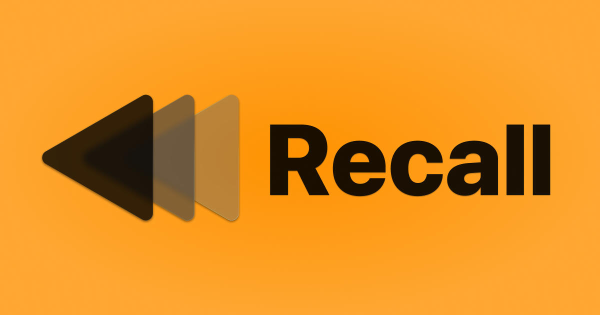
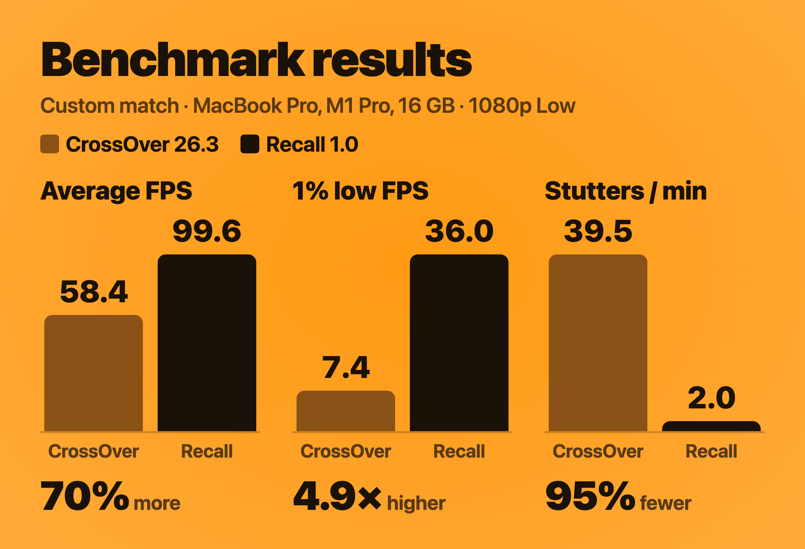

<h1 align="center">
  
</h1>

<a href="README.md">English</a> · 简体中文 · <a href="README.ko.md">한국어</a>

<h3 align="center">在 Mac 上玩守望先锋。</h3>

Recall 是一款免费、开源的 App，让你在 Apple 芯片 Mac 上玩守望先锋。

  

M1 或更新 · macOS 26.5 或更高版本 · 已通过 Apple 公证 · 支持国服战网

<b>国服玩家：</b>Recall 1.5 支持国服战网和简体中文界面。<a href="https://github.com/AsherJN/recall/releases/latest">下载 Recall</a>

Josh 制作 · <a href="#为什么做-recall">支持这个项目</a>

<table align="center">
  <tr>
    <td align="center" width="50%"><h2>+70%</h2>平均帧率</td>
    <td align="center" width="50%"><h2>5×</h2>1% 低帧</td>
  </tr>
  <tr>
    <td align="center"><h2>95%</h2>卡顿减少</td>
    <td align="center"><h2>最高 66×</h2>鼠标更新频率</td>
  </tr>
</table>

与 CrossOver 在同一台 14 英寸 MacBook Pro（M1 Pro，16 GB）、同一场自定义比赛中对比。鼠标：使用 8,000 Hz 鼠标时，Recall 每秒最多更新 8,000 次，CrossOver 为 120 次。

https://github.com/user-attachments/assets/c0f5cac1-67fb-4b75-8bf9-06ccf402ae42

<i>CrossOver 26.3 与 Recall，帧率实时数据来自 Apple 的 Metal 性能 HUD。自定义游戏 929PJ，由 <a href="https://www.reddit.com/r/linux_gaming/comments/1u4oanq/auto_precompile_shaders_for_overwatch_for_peak/">u/Working_Dealer_5102</a> 制作。</i>

Recall 为 Apple 芯片 Mac 带来最优化、最顺畅的守望先锋体验。它会为你完成所有设置：登录战网、安装守望先锋、点按“开始游戏”，和在 PC 上一样。游戏在你的 Mac 上本地运行，不需要安装 Windows、购买 CrossOver 许可，也不需要输入终端命令。

## 为什么选择 Recall

- **比赛更流畅。** 在同一台 Mac、同一场比赛中，Recall 的平均帧率比 CrossOver 高 70%，1% 低帧接近其五倍，卡顿减少 95%。
- **MetalFX 超分辨率带来更高帧率。** 守望先锋渲染更少的像素，再由 Apple 的 MetalFX 重建完整分辨率的画面：在 1440p、“高”预设下，帧率最多提高 77%。[工作原理](docs/METALFX.md)（英文）。
- **瞄准跟得上。** Recall 绕过 macOS 的鼠标层直接读取你的鼠标，并把每一次更新都传给游戏：使用 8,000 Hz 鼠标时每秒最多 8,000 次。你的甩枪和跟枪更快到达游戏，并精准落在你手指向的位置。
- **免费。** 没有价格、试用期、订阅、广告或账号。代码开源。
- **下载、登录、开玩。** Recall 会安装所需的一切并为你打开战网。可以在 MacBook 屏幕或外接显示器上玩，带鱼屏和 5K 显示器也支持。
- **国服战网。** 设置时选择“国服”，用网易账号登录，即可在国服玩。Recall 的界面跟随 Mac 的语言，支持简体中文。

## Recall 与 CrossOver 对比

CrossOver 是在 Mac 上玩 Windows 游戏最流行的方式，所以它是最有意义的对比对象。我在 14 英寸 MacBook Pro（M1 Pro，16 GB）上用相同的游戏设置，分别在 CrossOver 26.3 和 Recall 中玩了相同的场景，并记录了每款 App 显示的每一帧。

  

| | CrossOver | Recall | 差异 |
|---|---:|---:|---:|
| **自定义比赛** | | | |
| 平均帧率 | 58.4 | **99.6** | +70% |
| 1% 低帧 | 7.4 | **36.0** | 4.9 倍 |
| 每分钟卡顿 | 39.5 | **2.0** | 减少 95% |
| **训练靶场** | | | |
| 平均帧率 | 84.0 | **120.7** | +44% |
| 1% 低帧 | 26.2 | **55.2** | 2.1 倍 |
| 每分钟卡顿 | 4.2 | **0.5** | 减少 88% |

1% 低帧是最慢的 1% 帧期间的帧率，也就是你在团战中感受到的掉帧。卡顿是指耗时超过 50 毫秒的一帧。两款 App 都以 1920 × 1080 全屏运行守望先锋，使用“低”预设，关闭垂直同步和动态渲染比例，系统为 macOS 26.6.2；CrossOver 使用其默认图形设置 D3DMetal。每次运行测量约两分钟的游戏过程，不含加载画面和菜单。完整结果和测试方法见[性能说明](docs/PERFORMANCE.md)（英文）。

想知道 Recall 是如何做到的？请参阅 [Recall 为什么更快](docs/HOW-IT-WORKS.md)（英文）。

**你的瞄准。** 守望先锋的胜负取决于甩枪和跟枪，所以鼠标输入如何到达游戏和帧率同样重要。CrossOver 要等 macOS 更新指针，每秒 120 次，而且每当游戏把隐藏的光标拉回屏幕中心时，都会丢掉一点你的移动。Recall 绕过 macOS 的鼠标层直接读取你的鼠标，并把每一次更新都传给游戏，使用 8,000 Hz 鼠标时每秒最多 8,000 次。它从不把光标拉回中心，所以你的移动不会丢失，也能更快到达游戏。首次使用时，Recall 会请你在 macOS 中允许“输入监控”；它只读取你的鼠标。[两者如何处理鼠标](docs/PERFORMANCE.md#mouse-input)（英文）。

**价格。** CrossOver 一年更新的价格为 74 美元，终身版为 494 美元。Recall 免费。

如果你玩很多 Windows 游戏，CrossOver 是合适的工具。如果你主要玩守望先锋，Recall 正是为它打造的。

价格为 CodeWeavers 2026 年 10 月的官网标价。

## 开始使用

1. **[下载 Recall](https://github.com/AsherJN/recall/releases/latest)**，打开磁盘映像，将 Recall 拖到“应用程序”。
2. **打开 Recall** 并按照设置步骤操作。选择你的战网（国际服或国服）和战网语言，Recall 会准备好一切并打开战网。
3. **登录战网**，安装守望先锋，然后点按“开始游戏”。

| 你需要 | |
|---|---|
| Mac | Apple 芯片：M1 或更新。不支持 Intel Mac。 |
| macOS | macOS Tahoe 26.5 或更高版本 |
| 内存 | 建议 16 GB |
| 储存空间 | 85–95 GB 可用空间，可在 Mac 或外置固态硬盘上 |
| 另外 | 免费的暴雪账号（国服战网需要网易账号）、互联网连接，以及 Rosetta（Recall 会在设置时检查） |

[安装指南](docs/INSTALLATION.md)（英文）有更多细节，包括如何把游戏安装到外置磁盘。

更喜欢 Homebrew？请参阅[使用 Homebrew 安装](docs/INSTALLATION.md#installing-with-homebrew)（英文）。

## 国服战网

Recall 可以为中国大陆的网易账号设置国服战网。设置时在“选择你的战网”中选择“国服”；已经设置好的话，可以在“设置 › 通用 › 战网区服”中切换。国际服和国服战网的账号互不相通，所以切换时 Recall 会把当前的安装移到废纸篓，再重新设置。

- **登录。** 国服战网会在网页浏览器中让你用网易账号登录。如果 Safari 没有返回战网，请把 Chrome 或 Firefox 设为默认浏览器；如果 Chrome 请求访问本地网络上的设备，请选择“允许”。
- **反作弊。** 国服守望先锋包含网易的反作弊程序。Recall 不会关闭它，但网易不支持在 Mac 上游戏。

## 为什么做 Recall

我是 Josh，毕业于 UCSB 技术管理硕士项目，热爱打造科技产品。我在 PC 守望先锋社区待了四年多，一直希望出差旅行时也能在 MacBook 上玩。

长期以来，Mac 游戏的口碑一直不好，多年来这也确实名副其实。Apple 芯片改变了这一切。这些 Mac 性能惊人，Apple 也终于开始投入游戏，我很希望看到更多开发者为已经在使用 Mac 的玩家开发游戏。守望先锋是我最想看到的那一款。

我做 Recall，是为了在等待的这段时间里，让大家在 Mac 上玩得更轻松。我希望暴雪最终能为 Mac 推出原生的守望先锋，也希望这样的项目能证明玩家确实有这份需求。在那之前，希望你玩得开心 :)

Josh

如果你想支持我的工作，可以试试 Mosaic News，这是我做的一款免费新闻 App，旨在以最透明、最可定制、最注重隐私的方式关注新闻。

你也可以请我喝杯咖啡，或者给这个仓库点个 Star，帮助更多 Mac 玩家找到 Recall。

  
  
  

## 常见问题

<b>真的免费吗？</b>

是的。没有价格、试用期、订阅、广告，也没有 Recall 账号，代码开源。守望先锋本身免费，所以你只需要一个暴雪账号（国服为网易账号）。如果 Recall 帮你省下了其他软件的费用，想表示感谢，可以[请我喝杯咖啡](https://ko-fi.com/asherjn)或试试 [Mosaic News](https://mosaicnews.app/?utm_source=recall&utm_medium=github&utm_campaign=readme) :)

<b>需要 CrossOver、Windows 或 Boot Camp 吗？</b>

不需要。Recall 自带在 Mac 上运行守望先锋所需的一切。你不需要购买 CrossOver 或安装 Windows，而且 Apple 芯片 Mac 上也没有 Boot Camp。

<b>我的账号安全吗？</b>

你登录的是战网本身，Recall 从不询问你的密码。Recall 不会修改守望先锋的游戏文件，不会向游戏注入代码，也不会读取游戏内存。它通过 Wine（CrossOver 所基于的技术）运行与战网安装的相同的 Windows 游戏。暴雪和网易都没有正式支持在 Mac 上玩守望先锋，无论是通过 Recall 还是其他方式。国服守望先锋包含网易的反作弊程序，Recall 不会关闭它。

<b>为什么最初几局会卡顿？</b>

守望先锋第一次用到某个着色器时，Mac 需要构建它，这会导致卡顿。每局比赛结束后，Recall 会准备好学到的着色器，所以比赛会越来越流畅。大多数玩家在 5 到 10 局内，或大约 10,000 到 15,000 个着色器时就能流畅游戏。

想加快速度，可以运行地图工坊代码 **929PJ** 5 到 10 分钟：依次选择**游戏 › 自定游戏 › 创建游戏 › 设置 › 导入代码**，粘贴代码并开始。也可以打开**游戏 › 自定游戏**，搜索 **500%** 并加入一场游戏。国服战网的服务器不支持国际服的地图工坊代码，国服玩家可以只用 500% 的方法。

<b>可以用外接显示器吗？</b>

可以。在 macOS 的“系统设置”中把它设为主显示器，然后在守望先锋的视频设置中选择它的分辨率，Recall 会记住。请参阅[显示器设置说明](docs/SUPPORT.md#id-external-monitor)（英文）。

<b>可以把游戏装在外置磁盘上吗？</b>

可以。在设置时选择外置固态硬盘，玩的时候保持连接即可。[安装指南](docs/INSTALLATION.md)（英文）介绍了支持的格式和设置方法。

<b>守望先锋或 macOS 更新后会怎样？</b>

守望先锋照常通过战网更新。如果暴雪或 macOS 的更新需要在 Mac 这边修复，修复会以 Recall 更新的形式提供。Recall 打开时会检查新版本，由你决定何时安装。Recall 学到的着色器在更新后都会保留，不必从头开始。

<b>如何卸载？</b>

选择“设置 › 卸载 Recall”。它会把 Recall 和它管理的游戏安装移到废纸篓。你的账号不受影响。详情请参阅[卸载](docs/SUPPORT.md#uninstalling)（英文）。如果你是用 Homebrew 安装的 Recall，请改为运行 `brew uninstall --zap --cask recall`。

## 帮助与贡献

有问题可以在 GitHub 上提问。如果你能访问 Discord，也欢迎加入 [Recall Discord](https://discord.gg/pexasKezCn)，获取帮助、交流配置，结识其他在 Mac 上玩守望先锋的玩家。

[报告错误](https://github.com/AsherJN/recall/issues/new?template=bug_report.yml) · [分享在你的 Mac 上的运行情况](https://github.com/AsherJN/recall/issues/new?template=performance_report.yml) · [提出建议](https://github.com/AsherJN/recall/issues/new?template=feature_request.yml)

故障排除和隐私信息请参阅[支持与隐私](docs/SUPPORT.md)（英文）。分享报告前，请删除账号名称和个人文件路径。

对代码感兴趣？请从[架构说明](docs/DEVELOPMENT.md)和[构建说明](docs/BUILDING.md)（英文）开始。

Recall 使用 CodeWeavers 公开的 CrossOver 源代码中的 Wine、Feifan He 开发并经 NerRobDog 分支的 DXMT，以及 Soju 的运行时构建方案。Recall 的原创代码采用 [Apache 2.0](LICENSE) 许可；依赖项和补丁沿用各自的许可。请参阅[第三方声明](THIRD_PARTY_NOTICES.md)。

Recall 是独立的社区项目，与暴雪娱乐、网易、Apple 或 CodeWeavers 无关联，亦未获其认可。Overwatch（守望先锋）、Mac、CrossOver 及其他产品名称是其各自所有者的商标。
